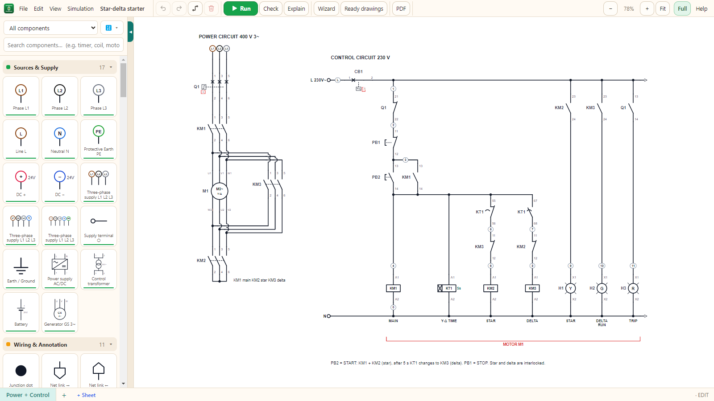
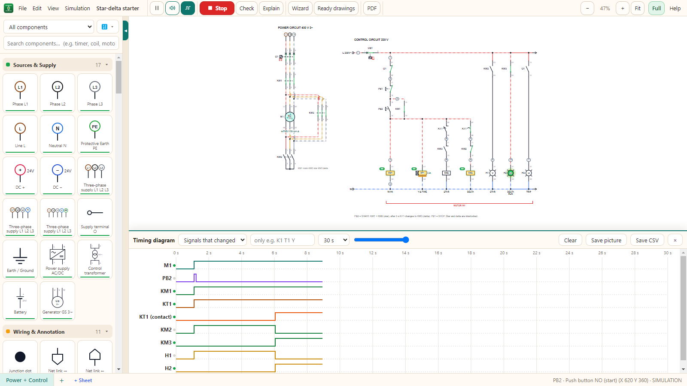
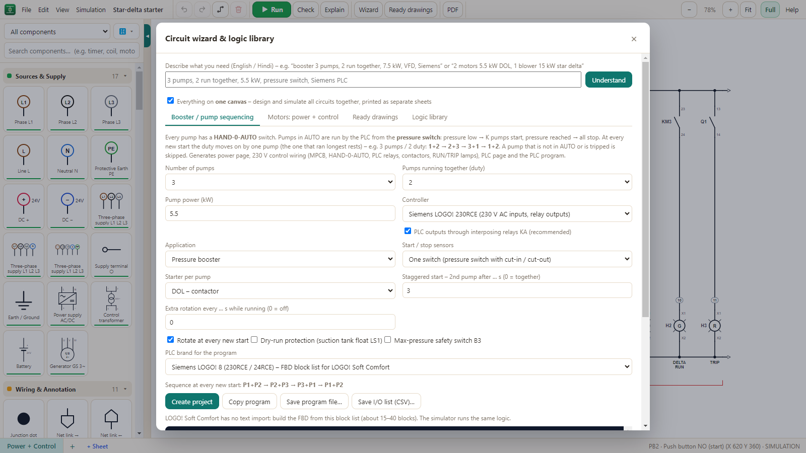
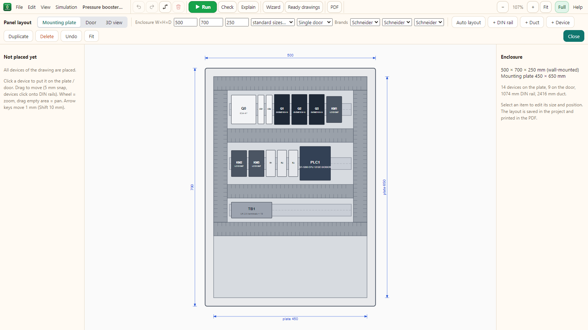
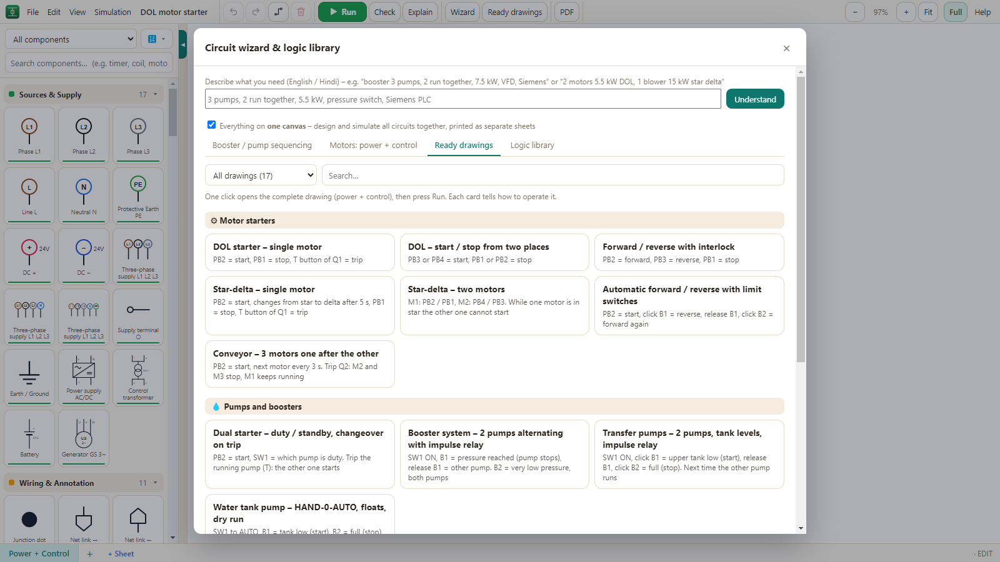
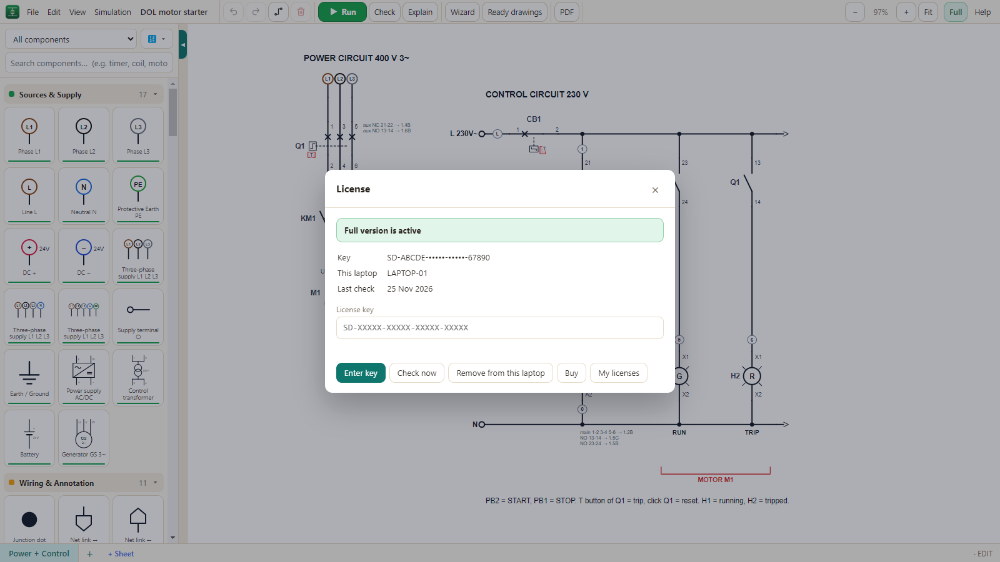

# SimuDaily — electrical drawing and simulation for Windows

**Draw electrical control circuits, run them live and print them as PDF.**
One app for design, simulation and learning — made by [FixIt Daily](https://fixitdaily.org/simudaily/).

### [⬇ Download SimuDaily for Windows (free)](https://github.com/fixitdailyapp/simudaily/releases/latest/download/SimuDaily-Windows-x64.zip)

Version 2.0.0 · Windows 10 / 11, 64-bit · about 110 MB · [All versions](https://github.com/fixitdailyapp/simudaily/releases)



---

## Free and Full — one program

Everybody downloads the same program. Without a key it runs as the **Free version**.
Buy a one-time license key on [fixitdaily.org/simudaily](https://fixitdaily.org/simudaily/) and the **Full version** opens at once — no new download, no subscription.

| Free | Full |
|---|---|
| Contactors, relays, MCBs, overloads, fuses | Everything in Free |
| Push buttons, emergency stop, switches, lamps, motors | All timers, counters, impulse relays and valves |
| Limit and float switches | All sensors, signals and breakers |
| Automatic wiring and wire numbers | PLC with ladder and structured text, PLC program export |
| Simulation with sounds | Modbus TCP and Siemens S7 connection |
| Check (finds mistakes) and Explain | VFD, star-delta, two speed and DC motors, pneumatics |
| Timing diagram on screen | Wizard and "Describe what you need" |
| Open and simulate all ready drawings | PDF, print, picture, SVG and parts list export |
| Own projects: one sheet, up to 40 devices | Panel layout and 3D view, unlimited sheets and devices |



## Install in four steps

1. Click **Download** above and save the ZIP.
2. Right-click the ZIP → **Extract All**.
3. Open the folder and start **SimuDaily Setup.exe** → **Install**.
   If Windows shows "Windows protected your PC", click **More info → Run anyway** (the app is new and not yet signed).
4. Open SimuDaily. To unlock the Full version, click **Free** (top right), paste your key and click **Enter key**.

## Screenshots

| | |
|---|---|
|  |  |
|  |  |

## Check your download (optional)

SHA-256 of `SimuDaily-Windows-x64.zip` (version 2.0.0):

```
e7f40867da8e4d913ded86bacaa226bb7239d86c7afecc85bd7f31b5d46ee18e
```

In Windows PowerShell: `Get-FileHash .\SimuDaily-Windows-x64.zip`

## Help and license key

- App page, prices and license keys: **https://fixitdaily.org/simudaily/**
- Your keys and laptops: **My account → My licenses** on fixitdaily.org
- Questions: **business@fixitdaily.org**

This page only hosts the download. The source code is not public.
SimuDaily © FixIt Daily. All rights reserved — see [LICENSE](LICENSE.md).
